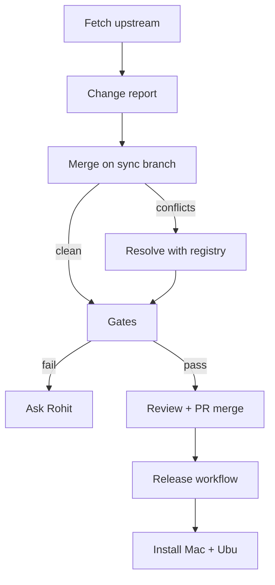

# Fork upstream sync skill

Status: draft for Rohit's approval (2026-11-21). Owner: Rohit. Each task is written so it can be
pasted as a worker prompt.

## Goal

One command, run by Rohit or the orchestrator, that brings `stablyai/orca` upstream into the fork's
`main` without breaking the Dart work, then ships it: a GitHub Release with downloadable Mac and
Linux files, and the same build installed on the Mac and on Ubu. Windows joins later, once the
Windows VM runner exists (see the Windows runner decision in long-term memory).

The skill stops and asks Rohit only when a conflict cannot be resolved safely, a Dart check fails,
or a step would discard work.

## Where it lives

In this repo, not in `orca-skills`: `.claude/skills/fork-upstream-sync/` (`SKILL.md` plus any
helper scripts). It is fork-only, so it gets an entry in `customization_registry.json`. Upstream
tracks only `.claude/settings.json` under `.claude/`, so the folder will not conflict.

## Facts (2026-11-21)

- Last sync: 2026-11-03, upstream `20442bc2c50`, fork merge `c4ba5022381`
  (`customization_registry.json` → `last_upstream_sync`).
- Upstream `main` is now `a6f32d22b2f`: 4,767 commits ahead of the merge base. The fork is 335
  commits ahead of upstream.
- 93 files are changed on both sides since the merge base. These are the likely conflicts.
  Known hot spots from earlier syncs: `src/shared/work-items/task-source-runtime-capabilities.ts`,
  `src/renderer/src/runtime/workspace-links/runtime-workspace-attachment-capabilities.ts`.
- The inventory of fork changes already exists: `customization_registry.json`, 10 entries
  (5 Dart, 5 fork infrastructure), each with key paths and edited upstream files.
- Existing pieces the skill reuses, not rewrites:
  - `config/fork/rebuild-and-install.sh`: fetch, merge upstream (`--no-ff`), `pnpm tc`, Dart tests,
    build, push. Modes `mac` and `server`; `--install-only` for Ubu.
  - `config/fork/install-built-app.sh`: Mac install from the built app.
  - `.github/workflows/fork-release.yml`: candidate branch, gates, builds macOS arm64, Linux x64,
    Windows x64, fast-forwards `main`, publishes a GitHub Release. Inputs `merge_upstream`, `force`.
- Known script bug: on headless Ubu, `rebuild-and-install.sh` exits 1 at its NOTIFY step (no
  D-Bus), so server mode stops before installing.

## Flow

## Skill steps

1. Preflight: Mac checkout and Ubu main checkout clean and on `main`; no open fork PRs touching the
   same files; Ubu reachable (`ensure-host.sh "Orca Ubu 7of9"`).
2. Change report: upstream commits and releases since `last_upstream_sync`, and the overlap
   between upstream's changed files and every `key_paths` / edited file in the registry. Written to
   `docs/plans/upstream-sync-<date>.md` so the run has a record.
3. Merge on a branch `sync/upstream-<date>` in the Ubu main checkout (integration runs on Ubu),
   never directly on `main`.
4. Conflicts: one builder in an Orca terminal on Ubu resolves them, briefed with the registry
   entries for each conflicted file. Rule: keep upstream's structure, re-apply the fork's change on
   top; never drop a registry customization. A conflict it cannot resolve with confidence stops the
   run and asks Rohit.
5. Gates, in order, one checkout: `pnpm install --frozen-lockfile`, `pnpm tc`, Dart tests
   (the paths `rebuild-and-install.sh` uses), `pnpm test` full suite, `pnpm lint`,
   `pnpm check:changed`. Failures that also fail on upstream `main` are recorded, not fixed.
6. Registry check: every customization's key paths still exist and its behaviour test passes.
   Live check: the Dart board, source chip and task detail on the Ubu web client (headless Canary).
7. Review: a separate review subagent on the merge diff limited to registry files plus conflict
   resolutions. Then push, open a PR against the fork's `main`, merge it (allowed without asking
   once gates and review pass).
8. Update `customization_registry.json` → `last_upstream_sync` in the same PR.
9. Release: run `fork-release.yml` on `main` with `merge_upstream=false`; wait with
   `gh run watch`. Result: a GitHub Release with the Mac zip, Linux files and (for now, on
   GitHub-hosted runners) the Windows setup.exe.
10. Install: Mac via `rebuild-and-install.sh --mode mac --no-upstream --no-push`, then the swap
    (Rohit runs it with `!`, since auto mode blocks quitting Orca); Ubu via `--mode server
    --no-upstream` then `--install-only`. Verify versions on both. No backups kept
    (Rohit, 2026-11-21): delete `/Applications/Orca.previous.app` and `/opt/Orca.previous`.
11. Report to Rohit in the status shape: what merged, release link, installed versions, anything
    recorded but not fixed.

## Tasks

### T1. Fix the headless NOTIFY exit in `rebuild-and-install.sh`

A failed `notify-send` must not fail the run. Accept: server mode builds and installs in one run on
Ubu. Update the `fork-rebuild-install` registry entry.

### T1b. One version string for CI and local builds

The 2026-11-21 manual release of `dd793404aa7` came out as `1.4.214-local…` from `fork-release.yml`
but `1.4.247-fork.local…` from `rebuild-and-install.sh` (which reads `config/fork/upstream-release`).
Make both read the same source so a release and an installed build of one commit share a version.

### T2. Write the skill

`.claude/skills/fork-upstream-sync/SKILL.md` covering steps 1-11, plus a change-report script
(`config/fork/upstream-change-report.sh`: commits, releases, registry overlap). Registry entry
`fork-upstream-sync-skill`.

### T3. First real run: today's sync

Run the skill on upstream `a6f32d22b2f` (or newer). This doubles as the skill's test; fix the skill
from what the run teaches.

### Later

- Windows: switch the `win-x64` job to the Windows VM runner once it exists.
- Schedule: once two manual runs pass cleanly, consider running it nightly.

## Routing

- T1, T2: done inline by the orchestrator (small, fork-only files).
- T3 conflict resolution: Claude Opus, high effort, in an Orca terminal on Ubu (large merge, risk of
  losing Dart code).
- Review: separate subagent, Claude Sonnet, medium effort; final review before merge, Claude Fable,
  max effort.

## Open questions for Rohit

1. Approve this plan, including the skill location and routing?
2. Should the skill pause for your OK before merging the sync PR, or merge on its own once gates and
   review pass (as for other fork PRs)?
